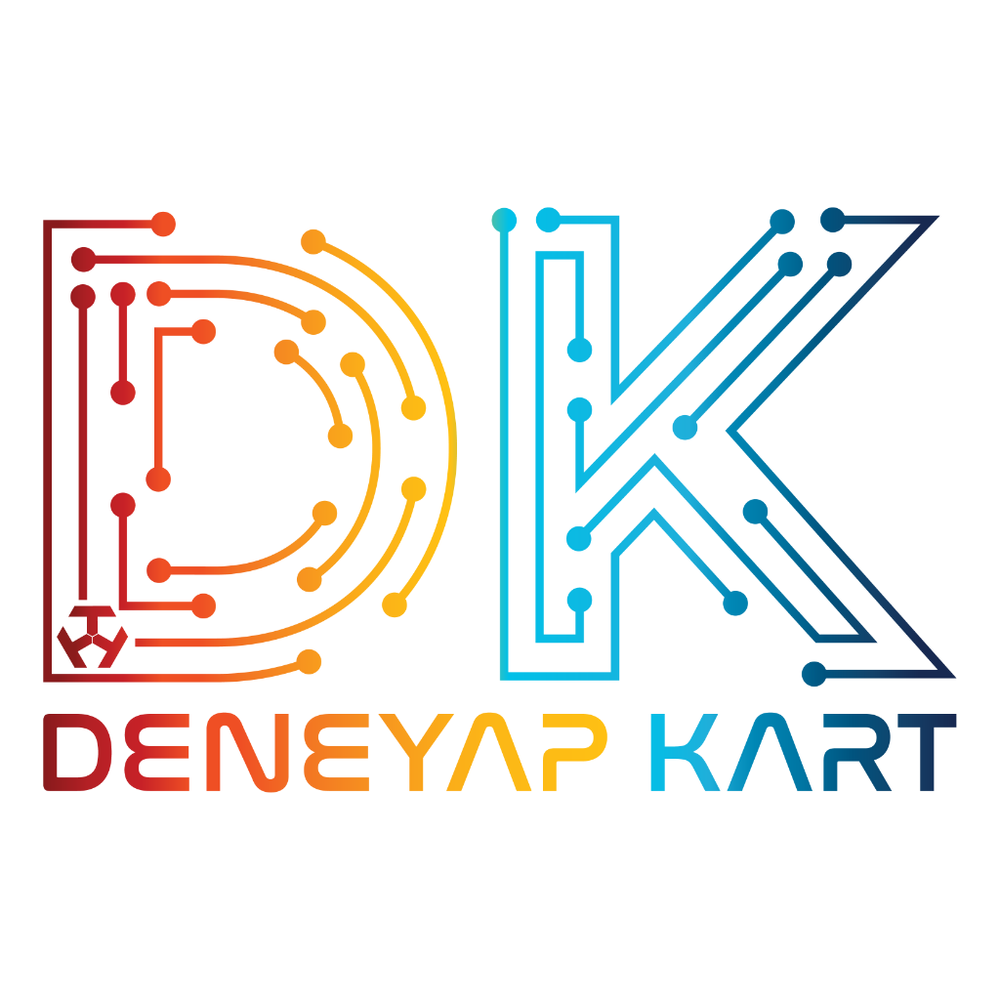

<p align="center">
  
</p>

<h1 align="center">Deneyap Blok IDE</h1>

<p align="center">
  <b>Windows Üzerinde %100 Çevrimdışı (Offline) Çalışan Deneyap Kart Blok Tabanlı Programlama IDE'si</b><br>
  <i>Google Blockly &bull; Yerel C++ Kod Üretimi &bull; Gömülü Offline Derleyici (Xtensa/RISC-V) &bull; USB Doğrudan Yükleme &bull; Dahili Seri Monitör</i>
</p>

<p align="center">
  
  
  
  
  
</p>

---

## 📌 Bu Proje Nedir?

**Deneyap Blok IDE**, T3 Vakfı ve Sanayi ve Teknoloji Bakanlığı öncülüğünde geliştirilen milli geliştirme kartımız **Deneyap Kart** ailesi için tasarlanmış, **bilgisayarda hiçbir internet bağlantısına veya harici web tarayıcısına ihtiyaç duymadan çalışan** modern bir masaüstü IDE'dir.

Atölyelerde, TEKNOFEST hazırlıklarında veya internet erişiminin kısıtlı olduğu sınıf ortamlarında Deneyap Kart'ları bloklarla kodlamak ve USB üzerinden tek tıkla karta yüklemek için geliştirilmiştir.

---

## ⚡ Kullanım Yöntemleri

### 👥 1. Son Kullanıcılar İçin (Öğrenci, Öğretmen, Atölye)
> Hiçbir kodlama veya terminal bilgisi gerektirmez.

1. Sağ taraftaki **[Releases (Sürümler)](https://github.com/beratmentess/deneyap-blok-ide/releases)** sekmesine gidin.
2. En güncel `Deneyap-Blok-IDE-win-x64.zip` arşivini indirin.
3. Arşivi bir klasöre çıkartın.
4. `Deneyap Blok IDE.exe` dosyasına çift tıklayın!
5. **İnternet bağlantınız kapalı olsa dahi** blokları dizip **Derle** ve **Yükle** butonlarını kullanabilirsiniz.

---

### 💻 2. Geliştiriciler İçin (Kaynak Koddan Çalıştırma)
Projeyi geliştirmek, yeni bloklar eklemek veya kaynak koddan derlemek için:

```bash
# 1. Depoyu klonlayın
git clone https://github.com/beratmentess/deneyap-blok-ide.git
cd deneyap-blok-ide

# 2. Node.js bağımlılıklarını kurun
npm install

# 3. Yerel derleyiciyi ve Deneyap Core paketlerini otomatik kurun
npm run setup-toolchain

# 4. Geliştirme modunda başlatın
npm run dev
```

#### Paketleme (.exe Üretme):
```bash
npm run package
```
Üretilen çalıştırılabilir masaüstü uygulaması `release/win-unpacked/` klasöründe oluşacaktır.

---

## ✨ Temel Özellikler

| Özellik | Açıklama |
|---|---|
| **%100 Çevrimdışı Çalışma** | CDN kullanılmaz. Blockly, `arduino-cli`, Xtensa GCC (`esp-x32`), RISC-V GCC (`esp-rv32`) ve `esptool` uygulamanın içine yerleşiktir. |
| **Tam Türkçe Arayüz** | Tüm kategoriler, bloklar, açıklamalar, terminal logları ve ipuçları Türkçedir. |
| **Canlı C++ Kod Önizleme** | Blokları sürüklediğiniz anda sağ panelde standart Arduino/ESP32 C++ kodu (`setup()`, `loop()`) renklendirilmiş olarak akar. |
| **Otomatik COM Port Algılama** | Kart takıldığında USB Vendor ID / Product ID'ye göre kartı otomatik tanır. |
| **Doğrudan USB Yükleme** | "Yükle" dendiğinde Blok &rarr; C++ &rarr; Yerel Derleme &rarr; USB Flaşlama zinciri arka planda çalışır. |
| **Dahili Seri Monitör** | Harici bir uygulama açmadan IDE içinde baud hızı ayarı, veri gönderme/okuma ve otomatik kaydırma. |
| **Proje Dosyası (`.dblock`)** | Blok çalışma alanı, seçili kart ve proje ayarları tek bir `.dblock` dosyasında saklanır, açılır ve farklı kaydedilebilir. |

---

## 🧩 Desteklenen Blok Kategorileri (25+ Özel Blok)

- 🔷 **Deneyap:** Dahili kullanıcı butonu (`GPKEY`) okuma.
- 🔌 **Giriş / Çıkış (GPIO):** Dijital pin yaz/oku, Analog pin oku (0-4095), PWM çıkışı (0-255).
- 💡 **Dahili RGB LED:** Hazır renk seçimi (Kırmızı, Yeşil, Mavi vb.) veya RGB 0-255 tonlama (Active-Low sürücü uyumlu).
- ⏱️ **Zaman:** Milisaniye gecikme (`delay`), çalışma zamanı sayacı (`millis`).
- 🧠 **Mantık & Matematik & Döngü:** Eğer/değilse, karşılaştırmalar, döngüler, rastgele sayı, aritmetik işlemler.
- 🔤 **Metin & Değişken & Fonksiyon:** Metin birleştirme, değişken tanımlama/atama, özel fonksiyon oluşturma ve çağırma.
- ⚙️ **Servo Motor:** Açı konumlandırma (`ESP32Servo`).
- 🔊 **Ses (Buzzer):** İstenen frekans ve sürede ton çalma, buzzer susturma.
- 📟 **LCD I2C Ekran:** `LiquidCrystal_I2C` ile 16x2 ve 20x4 ekran başlatma, koordinata yazı yazma, temizleme.
- 🔄 **Step Motor:** `Stepper` ile 28BYJ-48 motorlarda adım sayısı ve RPM hız kontrolü.
- 🏷️ **RFID Modülü:** `MFRC522` SPI kart algılama ve UID okuma.
- 📡 **Bluetooth (Classic):** Dahili Bluetooth başlatma, veri gönderme ve okuma.
- 📏 **Algılayıcılar:** HC-SR04 / Deneyap Ultrasonik modülü ile cm cinsinden mesafe okuma.

---

## 🎯 Desteklenen Deneyap Kart Modelleri

IDE içerisindeki üst açılır menüden kart değiştirildiğinde pin haritaları ve derleme hedefleri (FQBN) otomatik olarak güncellenir:

| Kart Adı | Mikrodenetleyici | Mimari | FQBN Tanımı | Dahili Özellikler |
|---|---|---|---|---|
| **Deneyap Kart** | ESP32-WROVER | Xtensa Dual-Core | `deneyap:esp32:deneyapkart` | IMU (LSM6DSM), Mikrofon, RGB LED |
| **Deneyap Kart 1A** | ESP32-WROOM-32 | Xtensa Dual-Core | `deneyap:esp32:deneyapkart1A` | RGB LED, Wi-Fi / Bluetooth |
| **Deneyap Kart 1A v2** | ESP32-S3 | Xtensa Dual-Core | `deneyap:esp32:deneyapkart1Av2` | Yerel USB, Adreslenebilir RGB LED |
| **Deneyap Kart G** | ESP32-C3 | RISC-V 32-bit | `deneyap:esp32:deneyapkartg` | Tek Çekirdek RISC-V, RGB LED |
| **Deneyap Mini** | ESP32-S2 | Xtensa Single-Core | `deneyap:esp32:deneyapmini` | Kompakt Boyut, Yerel USB |
| **Deneyap Mini v2** | ESP32-S2 | Xtensa Single-Core | `deneyap:esp32:deneyapminiv2` | Güncel Revizyon, Yerel USB |
| **Deneyap Kart v2** | ESP32-S3 | Xtensa Dual-Core | `deneyap:esp32:deneyapkartv2` | IMU, Genişletilmiş Sensör Desteği |

---

## 🛠️ Sistem Mimarisi

```
deneyap-blok-ide/
├── src/
│   ├── core/
│   │   ├── boards/             # 7 kartın gerçek pin ve FQBN tanımları
│   │   └── types/              # TypeScript veri modelleri
│   ├── main/
│   │   ├── electron/           # Ana süreç & ContextBridge güvenli IPC
│   │   ├── compiler/           # Yerel arduino-cli çağrıcı ve toolchain yöneticisi
│   │   ├── uploader/           # Derle-ve-Yükle (esptool) orkestrasyonu
│   │   └── serial/             # Dahili seri port sürücüsü
│   └── renderer/
│       ├── blockly/
│       │   ├── blocks/         # Özel Deneyap blok tanımları
│       │   ├── generators/     # Blok -> Arduino C++ dönüştürücüleri
│       │   └── toolbox/        # Türkçe kategori ve blok menüsü
│       ├── components/         # Header, Kod Önizleme, Terminal, Seri Monitör
│       └── assets/             # Deneyap Kart logoları
├── scripts/
│   └── setup-toolchain.ps1     # Yerel derleyici paketlerini indiren betik
└── toolchain/                  # Gömülü derleyici (arduino-cli + core paketleri)
```

---

## ❓ Sıkça Sorulan Sorular (SSS)

<details>
<summary><b>1. Karta kod yüklerken "Port bulunamadı" veya "Port açılamadı" hatası alıyorum, ne yapmalıyım?</b></summary>
Deneyap Kart'ınız bilgisayara USB kablosuyla bağlıyken Aygıt Yöneticisi'nde COM bağlantı noktasının göründüğünden emin olun. Kablonuzun yalnızca şarj kablosu değil, veri (data) aktaran bir kablo olduğunu kontrol edin. CH340 veya CP210x USB-Seri sürücülerinin kurulu olduğundan emin olun.
</details>

<details>
<summary><b>2. Yükleme sırasında "Seri port meşgul" hatası alıyorum?</b></summary>
Uygulama yükleme başlatırken dahili Seri Monitör'ü otomatik olarak kapatır. Ancak arka planda başka bir seri port izleme programı (Arduino IDE seri portu, PuTTY vb.) açıksa portu serbest bırakmanız gerekir.
</details>

<details>
<summary><b>3. Gerçekten hiç internet olmadan çalışıyor mu?</b></summary>
Evet! Uygulama açılışta hiçbir CDN'e veya uzak sunucuya bağlanmaz. Blok kütüphaneleri, C++ derleyicisi ve USB flaşlayıcı tamamen bilgisayarınızdaki yerel dosyalardan çalıştırılır.
</details>

---

## 📄 Lisans

Bu proje **MIT Lisansı** ile lisanslanmıştır. Eğitim ve ticari olmayan/olan tüm amaçlarla özgürce kullanılabilir, geliştirilebilir ve dağıtılabilir.
